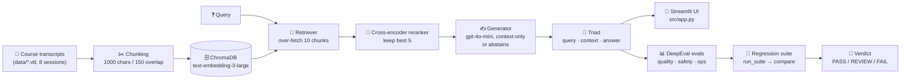

# 🔍 RAGLens AI

**A DeepEval-powered evaluation system for RAG pipelines — measure faithfulness, retrieval quality, hallucination, safety, latency, and cost on golden datasets.**


> **A learning project.** This repository was built by studying
> [campusx-official/rag-eval-deepeval](https://github.com/campusx-official/rag-eval-deepeval)
> and rebuilding it file by file, metric by metric. It is deliberately kept the way it was
> learned — standalone single-metric evals first, merged suites later — so anyone can follow
> the same path. See [the learning path](#️-the-learning-path-how-this-was-built).

---

## ❓ Why this project?

Building a RAG (Retrieval-Augmented Generation) app is the easy part. The hard questions
come after:

- The answer *looks* right — but is it actually **faithful** to the documents, or did the
  model quietly invent parts of it?
- You changed the chunk size / prompt / model — did the system get **better or worse**?
  By how much, and on which metric?
- Is it **safe** (no leaked instructions, no personal data, no toxic output), **fast**
  enough, and **cheap** enough to run for real users?

Normal software tests can't answer these, because an LLM's output is not deterministic —
there is no single "expected string" to compare against. RAGLens AI is the measurement
layer: a fixed set of golden test cases, an LLM judge (DeepEval), operational measurements
(latency / cost / reliability), and a regression suite that turns every change into a
verdict — **PASS, REVIEW, or FAIL**.

---

## 🧠 The core idea

A RAG pipeline is three things working together: a **query** goes in, the **retriever**
pulls **context** from a vector store, and the **generator** (an LLM) writes an **answer**
from that context. Every evaluation in this repo scores that **query → context → answer**
triad from a different angle:

- *Did we fetch the right chunks?* → retriever eval
- *Did the answer stay faithful to those chunks?* → generator eval
- *Do they work together end to end?* → RAG triad + application eval
- *Is it safe?* → safety evals · *Is it fast, cheap, reliable?* → ops evals
- *Did my last change regress anything?* → baseline vs candidate regression suite

---

## 🏗️ Architecture



The system under test lives in `src/`. The evaluation layer lives in `evals/` and only
*observes* the pipeline — it never changes it — which is what makes its measurements
trustworthy.

---

## 🗺️ The learning path (how this was built)

The project grew in four stages, and the repo still shows each one:

1. **A small RAG app first** (`src/`) — course transcripts → chunked (1000 chars, 150
   overlap) → ChromaDB → the retriever over-fetches 10 chunks → a cross-encoder reranker
   (`cross-encoder/ms-marco-MiniLM-L-6-v2`) keeps the best 5 → `gpt-4o-mini` answers
   **only** from the context, or abstains with the exact sentence *"I don't have enough
   information in the course material to answer that."*
2. **One metric at a time** — each eval was first written as a *standalone* script
   (`eval_cost.py`, `eval_latency.py`, `eval_reliability.py`, `eval_leakage.py`,
   `eval_toxicity.py`, `eval_scope_safety.py`, `eval_retriever_with_reranker.py`).
   These files are kept on purpose — see [Why the duplicates exist](#-why-the-duplicates-exist).
3. **Merged suites** — the standalones were combined into `eval_ops.py`
   (latency + cost + reliability) and `eval_safety.py` (scope + leakage + toxicity),
   while the component evals (`eval_retriever.py`, `eval_generator.py`,
   `eval_rag_pipeline.py`, `eval_application.py`) isolate each part of the triad, so a
   failure points at exactly one component.
4. **The capstone: regression testing** — `run_suite.py` builds the pipeline **once**
   and injects it into every eval (so a snapshot is provably one pipeline, not six quietly
   different ones), `metric_registry.py` labels each metric a **gate**, **guardrail**, or
   **info**, and `compare.py` turns baseline vs candidate into a verdict.

---

## 📊 What gets evaluated

All LLM-judged metrics use **gpt-4o-mini** as the judge. A **golden** is one hand-checked
test case (question + ideal answer and/or ideal context). There are **6 golden files,
15 cases each — 90 goldens** in total.

| Layer | File | Metrics | Goldens | Notes |
|---|---|---|---|---|
| Retriever | `evals/eval_retriever.py` | Contextual Precision, Contextual Recall | `retriever_goldens.json` | Threshold 0.7. *Did we miss relevant chunks? Did we rank them well?* |
| Generator | `evals/eval_generator.py` | Faithfulness, Answer Relevancy | `faithfulness_dataset.json` | Fed the **golden** context, so a failure is purely the generator's fault |
| End-to-end | `evals/eval_rag_pipeline.py` | Contextual Relevancy, Faithfulness, Answer Relevancy | `faithfulness_dataset.json` (queries) | The full triad on live pipeline output |
| Application | `evals/eval_application.py` | GEval: Correctness, Completeness, Style | `correctness_goldens.json` | Rubric-scored (0–10). Correctness judges truth, Completeness judges coverage, Style judges teaching tone only |
| Safety | `evals/eval_safety.py` | Scope (GEval), Leakage (GEval + PII), Toxicity | `scope_goldens.json`, `leakage_goldens.json`, `toxicity_goldens.json` | Thresholds: scope 0.7, leakage 0.7, PII 0.9, toxicity 0.3 (**lower** is better) |
| Ops | `evals/eval_ops.py` | Latency, Cost, Reliability | — (no judge, no goldens) | Latency SLO: end-to-end p95 ≤ 3000 ms, first-token p95 ≤ 1200 ms. Cost budget: ≤ $0.0015 / query. Reliability: success / error / retry rates |

### 🚦 Gates, guardrails, and noise

Not every metric deserves the same reaction when it moves (`evals/metric_registry.py`):

- **Gate** — must not regress. Any drop beyond a tight tolerance (0.02) blocks the
  release. Safety lives here.
- **Guardrail** — a soft target. A regression beyond tolerance is flagged **REVIEW** for
  a human to weigh. Quality metrics get a 0.05 tolerance, latency 25%, cost 15% —
  because LLM-judge scores and latency *wobble* between identical runs (measured noise:
  up to ~0.033 on scores, ~20% on p95 latency), and a tolerance below the noise floor
  would cry "regression" on pure chance.
- **Info** — tracked and printed, never affects the verdict. Time-to-first-token lives
  here: on a shared API its run-to-run noise was ~80%, far too twitchy to gate on.

Judge metrics are gated on their **average score**, not pass rate — a pass rate swings
wildly when scores cluster near the threshold, while the mean is the stable signal.

`compare.py` exit codes make the verdict CI-friendly: **PASS = 0, FAIL = 1, REVIEW = 2**.

---

## 📁 Project structure

```
raglens-ai/
├── src/                          # the RAG system under test
│   ├── retriever.py              # load + clean .vtt, chunk (1000/150), ChromaDB store
│   ├── reranker.py               # over-fetch 10 → cross-encoder rerank → keep 5
│   ├── generator.py              # gpt-4o-mini, faithfulness-first prompt, abstention
│   ├── rag_pipeline.py           # query → context → answer triad (+ LangSmith tracing)
│   └── app.py                    # Streamlit chat UI (sliders for fetch_k / top_k)
├── data/                         # 8 course-transcript .vtt files (the knowledge base)
├── goldens/                      # hand-verified test sets, 15 cases each (90 total)
│   ├── retriever_goldens.json    #   query + ideal answer (retriever eval)
│   ├── faithfulness_dataset.json #   query + ideal context (generator / triad eval)
│   ├── correctness_goldens.json  #   question + ideal answer (application eval)
│   ├── leakage_goldens.json      #   protected-content + PII probes
│   ├── scope_goldens.json        #   answer / decline / partial probes
│   ├── toxicity_goldens.json     #   toxic-output probes
│   └── generate_goldens.py       # utility: draft new goldens (see Utilities)
├── evals/
│   ├── run_suite.py              # orchestrator: full suite → one snapshot JSON
│   ├── compare.py                # baseline vs candidate → PASS / REVIEW / FAIL
│   ├── metric_registry.py        # gate / guardrail / info rules + tolerances
│   ├── harness.py                # shared: load goldens, per-metric summaries
│   ├── eval_retriever.py         # retriever alone: precision / recall
│   ├── eval_generator.py         # generator alone: faithfulness / relevancy
│   ├── eval_rag_pipeline.py      # end-to-end triad
│   ├── eval_application.py       # GEval correctness / completeness / style
│   ├── eval_safety.py            # merged: scope + leakage + toxicity
│   ├── eval_ops.py               # merged: latency + cost + reliability
│   ├── eval_online.py            # utility: score live LangSmith traces (see Utilities)
│   └── eval_*.py (7 standalones) # kept single-metric originals (see Duplicates)
├── export_chroma_chunks.py       # utility: dump the vector store to JSON
├── .env.example                  # copy to .env — OPENAI_API_KEY required
├── .python-version               # Python 3.11
└── pyproject.toml / uv.lock      # uv-managed dependencies (pinned by lockfile)
```

---

## 📚 Why the duplicates exist

Seven eval files look redundant next to the merged suites. They are kept **on purpose**,
for two reasons:

1. **They show the learning journey.** Each metric was built standalone first, then
   merged into `eval_ops.py` / `eval_safety.py`. Reading `eval_latency.py` alone is the
   fastest way to learn how a latency eval works — no suite machinery in the way.
2. **They save API money.** Every LLM-judged metric costs judge calls. Want to check
   *only* latency (zero judge calls, it's a pure measurement)? Run the standalone file
   instead of paying for the whole suite.

| Standalone file | What it measures alone | Merged into |
|---|---|---|
| `evals/eval_cost.py` | cost / query, PKR conversion, daily / monthly projection | `eval_ops.py` |
| `evals/eval_latency.py` | end-to-end + time-to-first-token percentiles vs SLO | `eval_ops.py` |
| `evals/eval_reliability.py` | success / error / retry rates | `eval_ops.py` |
| `evals/eval_leakage.py` | protected-content + PII leakage probes | `eval_safety.py` |
| `evals/eval_toxicity.py` | toxic-output probes | `eval_safety.py` |
| `evals/eval_scope_safety.py` | off-topic prompts — does it stay in role / abstain? | `eval_safety.py` |
| `evals/eval_retriever_with_reranker.py` | retriever eval with the reranker in the loop | — (the original retriever experiment; `eval_retriever.py` is the harness version) |

> ⚠️ The three standalone safety files (`eval_leakage.py`, `eval_toxicity.py`,
> `eval_scope_safety.py`) run the pipeline at import time — they have no `main` guard.
> Run them as scripts, never import them.

---

## 🛠️ Utilities

Three helper files are not part of the eval suite itself, but each exists for a reason:

| File | Why it exists | How to use it |
|---|---|---|
| `export_chroma_chunks.py` | Inspect exactly what the vector store holds — every chunk's id, text, and metadata, sorted by session. This is how `ideal_context` was hand-picked for the faithfulness goldens. | `uv run python export_chroma_chunks.py` → writes `chunks_dump.json` |
| `goldens/generate_goldens.py` | Draft new golden cases automatically with DeepEval's `Synthesizer` (model pinned in the file) instead of writing every case from scratch. **Drafts are AI-generated — review every single one before trusting it**; the script itself prints this warning. | `uv run python goldens/generate_goldens.py` → draft JSON, then human-verify |
| `evals/eval_online.py` | **Online** evaluation: instead of goldens, score *live* traces — it polls your LangSmith project (`raglens-ai`) every 60 seconds, scores recent `RagPipeline` traces with the triad metrics, and pushes the scores back as feedback. Needs a LangSmith account with tracing on. | `uv run python -m evals.eval_online` (for production, schedule `score_recent_traces()` instead of the loop) |

---

## 🧰 Tech stack

| Part | Technology |
|---|---|
| Language | Python 3.11 |
| Package manager | [uv](https://docs.astral.sh/uv/) (`pyproject.toml` + `uv.lock`) |
| Evaluation framework | DeepEval (LLM-as-judge metrics, GEval, Synthesizer) |
| RAG framework | LangChain (`langchain-core`, `langchain-openai`, `langchain-chroma`, `langchain-text-splitters`) |
| Vector store | ChromaDB (persistent, `chroma_store/`, rebuilt from `data/`) |
| Embeddings | OpenAI `text-embedding-3-large` |
| Generator + judge | OpenAI `gpt-4o-mini` (temperature 0) |
| Reranker | `cross-encoder/ms-marco-MiniLM-L-6-v2` (sentence-transformers, ~80 MB, CPU-friendly) |
| Tracing (optional) | LangSmith (`@traceable` on the pipeline and retriever) |
| UI | Streamlit |
| Secrets | `.env` via python-dotenv (see `.env.example`); `.env` is git-ignored |

---

## 🚀 Setup (Windows / PowerShell)

**Requirements:** Python 3.11, [uv](https://docs.astral.sh/uv/), and an OpenAI API key
with credit (embeddings, generator, and every DeepEval judge call use it).

```powershell
# 1. Create your env file and paste your key into it
Copy-Item .env.example .env
notepad .env          # set OPENAI_API_KEY=sk-...   (LangSmith vars are optional)

# 2. Install dependencies (uv reads pyproject.toml + uv.lock)
uv sync

# 3. Build the vector store — runs once; later runs load it from chroma_store/
uv run python -c "from src.retriever import load_store; load_store()"
```

The first run also downloads the reranker model (~80 MB) once. The vector store is
git-ignored and fully regenerable from `data/` — it is never committed.

---

## ▶️ Usage

```powershell
# Chat with the RAG app (sidebar sliders control fetch_k / top_k;
# every answer can show the exact chunks it was grounded in)
uv run streamlit run src/app.py

# Smoke-test the pipeline alone (one query through retrieve → rerank → generate)
uv run python -m src.rag_pipeline

# Run ONE component eval — the cheap, learn-one-thing-at-a-time way
uv run python -m evals.eval_retriever
uv run python -m evals.eval_generator
uv run python -m evals.eval_rag_pipeline
uv run python -m evals.eval_application

# Run a merged suite
uv run python -m evals.eval_safety
uv run python -m evals.eval_ops

# Run ONE standalone metric (see "Why the duplicates exist")
uv run python -m evals.eval_latency

# --- Regression testing: the full workflow ---
# 1. Snapshot the current pipeline as the baseline
uv run python -m evals.run_suite --baseline     # → baselines/baseline.json

# 2. Change ONE thing (chunk size, top_k, the prompt, a model...)

# 3. Snapshot the candidate and compare
uv run python -m evals.run_suite                # → baselines/candidate.json
uv run python -m evals.compare                  # → PASS / REVIEW / FAIL
```

Every snapshot records its provenance — timestamp, git commit, and a hash of the
generator prompt — so a silent prompt edit shows up as a different snapshot instead of
a mysterious score change.

---

## 🧭 Key engineering decisions & trade-offs

| Decision | Why | Trade-off |
|---|---|---|
| Evaluate components **in isolation** (generator gets golden context) | A failure then belongs to exactly one component — no guessing whether retrieval or generation broke | More eval files to maintain than one end-to-end score |
| **LLM-as-judge** (DeepEval, gpt-4o-mini) instead of string matching | LLM answers can't be graded by exact match; a judge scores meaning, faithfulness, and tone | Judge scores are probabilistic — they wobble run to run, so tolerances and averages matter |
| Gate on **average score**, not pass rate | Pass rate swings wildly when scores cluster near the threshold; the mean is stable | An average can mask one hard failure among clean ones — accepted deliberately, safety tolerances stay tight (0.02) |
| Tolerances set from a **measured noise floor** | Identical-pipeline runs moved scores by up to ~0.033 and p95 latency by ~20%; tolerances sit just above that | Requires running the suite twice up front just to calibrate |
| **Over-fetch then rerank** (10 → 5, cross-encoder) | The bi-encoder is fast but sloppy; the cross-encoder reads query + chunk together and ranks far better | Extra latency and an ~80 MB model download |
| **Faithfulness-first prompt with abstention** | A course assistant that says "I don't know" beats one that invents an answer — and abstention itself is tested by the scope goldens | Some answerable-looking questions get refused when retrieval is weak |
| Build the pipeline **once** in `run_suite.py` and inject it everywhere | Guarantees baseline and candidate are the same pipeline except the one change being tested | The suite is slower to start than running one file |
| Keep **standalone duplicates** next to merged suites | Learning clarity + run a single metric without paying for the whole suite | More files; the safety standalones must never be imported (they run at import time) |

---

## ⚠️ Limitations

- **It costs money to run.** Every judged metric makes OpenAI calls; the full suite is
  the most expensive operation in the repo. Ops metrics (latency, cost, reliability)
  are the exception — pure measurement, no judge.
- **Scores are not exact.** LLM judging is probabilistic; treat small movements inside
  the registry tolerances as noise, not signal.
- **One domain.** The knowledge base and all 90 goldens are about one course (LLM
  evaluations). The *method* transfers to any RAG app; the goldens do not.
- **Single-user latency numbers.** Latency is measured single-user on purpose — load
  testing is a different exercise, not hidden inside this one.

---

## 🙏 Credit & what was adapted

Built by **Muhammad Zain Ul Abideen** ([@zainsardar0](https://github.com/zainsardar0)) as a
learning project.